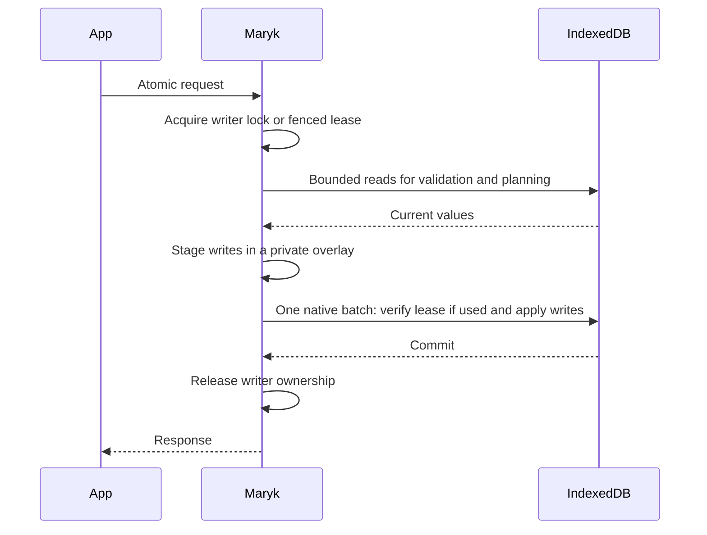

# IndexedDB Store Architecture

The IndexedDB store maps Maryk's ordered key-value storage model to browser-native IndexedDB primitives.

## Layers

`IndexedDbDataStore`

- Implements the Maryk datastore request surface.
- Reuses shared request/update logic where possible.
- Encodes Maryk keys, qualifiers, values, history rows, index rows, and unique rows.
- Chooses table, index, unique, history, or update-history paths per request.

`IndexedDbByteStore`

- Small common byte-store interface.
- Provides `get`, `put`, `delete`, `scan`, and `writeBatch`.
- Platform implementations live in `jsMain` and `wasmJsMain`.
- Tests inject `fake-indexeddb`; browser apps use the real browser IndexedDB implementation.

`IndexedDbScanBatches`

- Pages cursor scans in bounded batches.
- Lets Maryk request limits count matched rows after soft-delete/filter skips.
- Avoids full native range materialization for table/current-index/historic-index paths.

## Native IndexedDB Use

The store uses:

- object stores per Maryk model/family;
- `IDBKeyRange` bounds for start/end keys;
- forward and reverse cursors;
- direct object-store `get` for key and unique fast paths;
- native `readwrite` transactions for write batches.

Keys are stored as numeric arrays because IndexedDB array-key ordering preserves Maryk bytewise ordering. JS values are stored as `Int8Array` to avoid boxed value arrays.

## Mutation Consistency

The common Maryk processor suspends between validation, reads, scans, and write planning. Browser IndexedDB transactions become inactive when request queueing pauses across tasks, so the whole logical request is not wrapped in one native transaction.

Instead:

- mutation requests run under an exclusive Web Locks API lock when available;
- browsers without Web Locks use a renewable per-database lease stored atomically in IndexedDB;
- lease release notifications use `BroadcastChannel`, with timed retries as a compatibility fallback;
- fallback write batches verify the lease in the same native transaction, so an expired owner cannot commit;
- final writes are committed with one native IndexedDB `readwrite` batch transaction.

This gives good browser behavior without pretending IndexedDB transactions are long-lived coroutine scopes.

Atomic requests reuse the writer lock or fenced lease for the complete planning
phase. A coroutine-local byte-store overlay provides read-your-own-writes without
exposing staged data to background readers. Record writes, index/history changes,
commit-journal rows, the clock, and the retry receipt are sent to one native
`writeBatch`. Failed validation discards the overlay and its notifications.
The browser adapters explicitly implement `AtomicIndexedDbByteStore`; the generic
byte-store interface's sequential batch fallback does not establish this guarantee.

## Serializable transaction scopes

Interactive scopes replay an ordered read/write journal into the same private
byte-store overlay. Each preview holds the Maryk writer lock or fenced lease only
for that replay; application suspension retains no native IndexedDB transaction.
A datastore revision fence rejects changes by other Maryk writers between steps.
Commit publishes the final bytes, revision and retry receipt in one native batch.
Atomic requests use this engine with initial-state checks and a restricted write
set. See the [shared transaction contract](../../../core/docs/query.md#serializable-transactions).

## Versioning

`open` creates or upgrades all required object stores for the configured models and options. Existing connections close on `versionchange`, and blocked opens fail clearly instead of hanging.

The `meta` object store records:

- storage schema version;
- history options;
- model signatures;
- encoded model definitions;
- versioned per-model migration state. A `Running` marker is stored before each
  handler call; its phase, attempt, cursor, and `Partial`/`Retry`/fatal outcome
  diagnostics survive reopen. Successful completion removes the state.

The native JS/Wasm adapters stamp changes to guarded schema metadata in the same
fenced write batch. Before a read, a changed or missing cached revision triggers
full metadata validation. Reads spanning native transactions must finish with the
same revision they validated at the start, even if changed metadata was restored
in between. Idempotent metadata writes leave the revision unchanged. Other
adapters retain full metadata checks.

## Reads and projections

Current Gets of up to 256 keys can read record snapshots and the schema revision
in one native transaction. The schema is validated before value decoding. Historical
reads, referenced filters, legacy table fallbacks and larger requests may span
transactions, so they also validate the schema generation before publication.

Projections retain the fields needed for filtering, aggregations and index
ordering, then apply the requested response selection. Unsupported dependencies
use full decoding. Update-history filters use each event's version. Selecting
fewer fields therefore preserves which records match and hides fields read only
for query evaluation.

For snapshots of at least 64 KiB, native batch readers can prepare projections
over at most 64 roots, including selected collection and embedded subtrees.
Structural preparation retains at most 256 selected rows. Readers inspect row
spans before copying payloads and retain the original blob when selected qualifier
and value bytes exceed half its size or a preparation bound is exceeded. Narrower
results retain owned selected rows
as they arrive, preserving the original stored-row count, and release raw
references after use. Unfiltered current Gets can also reuse repeated records
from the same native snapshot; each result owns
its mutable containers. Legacy table fallback disables this reuse. See the
[shared cache contract](../../shared/docs/store-behavior.md#decoded-value-cache).

Current secondary-index scans fetch up to eight record snapshots together.
Windows shrink near the result limit and preserve index order and filtering.
Historical reads and adapters without native batching retain sequential reads.
Each snapshot blob is still fetched in full: these windows bound record counts,
not bytes or process memory. Full reads and browser garbage collection can make
peak memory higher than with sequential reads.

## Live-update journal

Ordinary reads without active listeners do not acquire the journal-maintenance
writer fence. Flow snapshots and state backups catch up the journal before their
boundary. With active listeners, unchanged commit and schema revisions can reuse
a recent catch-up; new commits or an aging consumer heartbeat trigger a fenced
drain and retention-gap check. Background notifications and polling continue to
refresh heartbeats.

Bulk mutations reuse journal preparation only while holding the same writer
fence. Each record still commits its data and journal entry together. When the
writer verifies that it is the sole consumer and the journal is empty, it can
prune immediately consumed entries and advance the floor in the data commit.
Peer registration uses that same fence; multiple consumers retain ordinary
journal retention.

## Relationship To Other Stores

IndexedDB follows the same Maryk request semantics as RocksDB/FoundationDB where browser constraints allow it:

- current table/index/unique scans are native cursor scans;
- historic reads use stored snapshots and historic secondary rows;
- update-history scans use an inverted version index when enabled;
- live flow listener state remains in memory, as in the other stores, while initial/refill reads come from IndexedDB.
